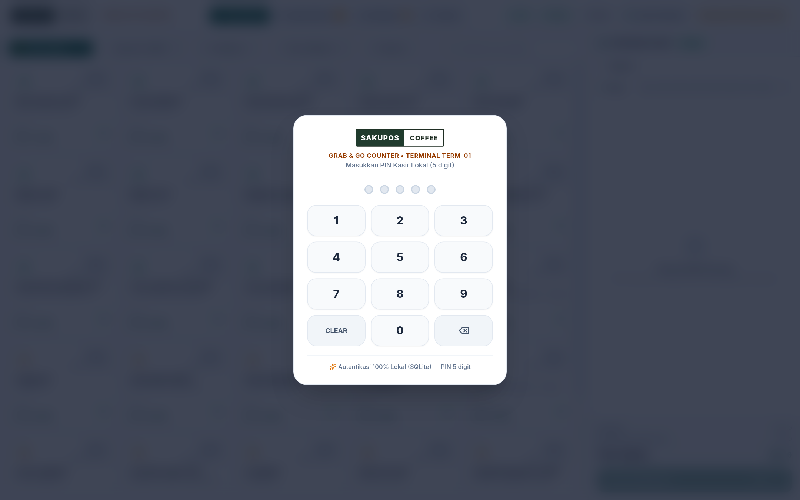
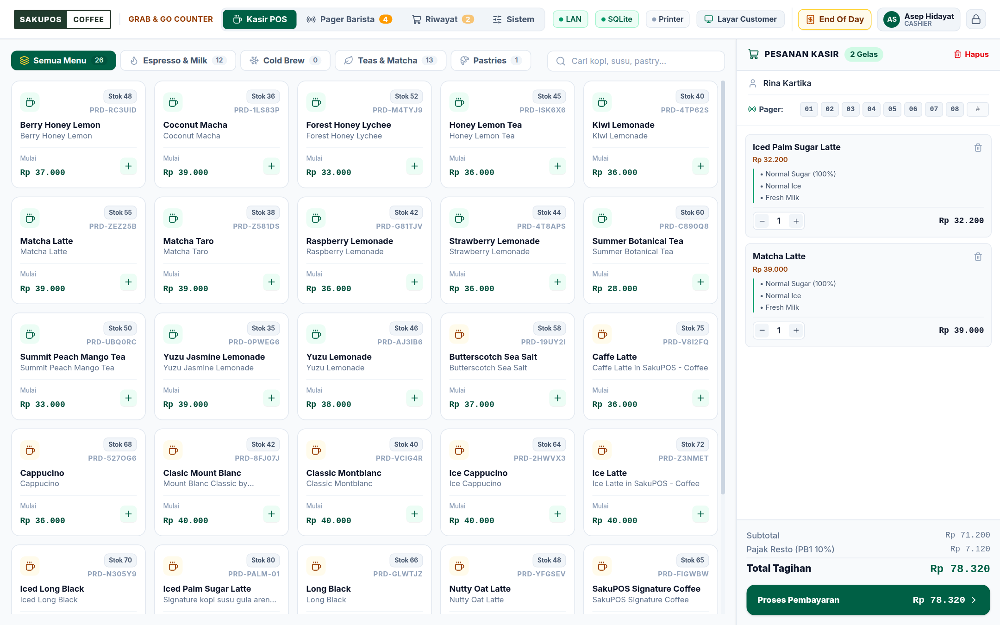
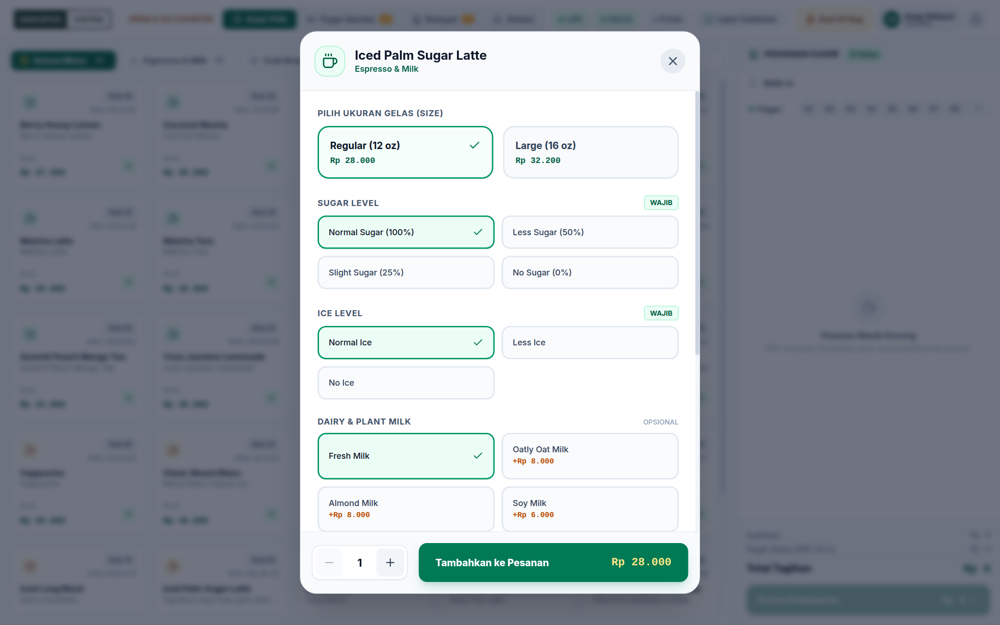
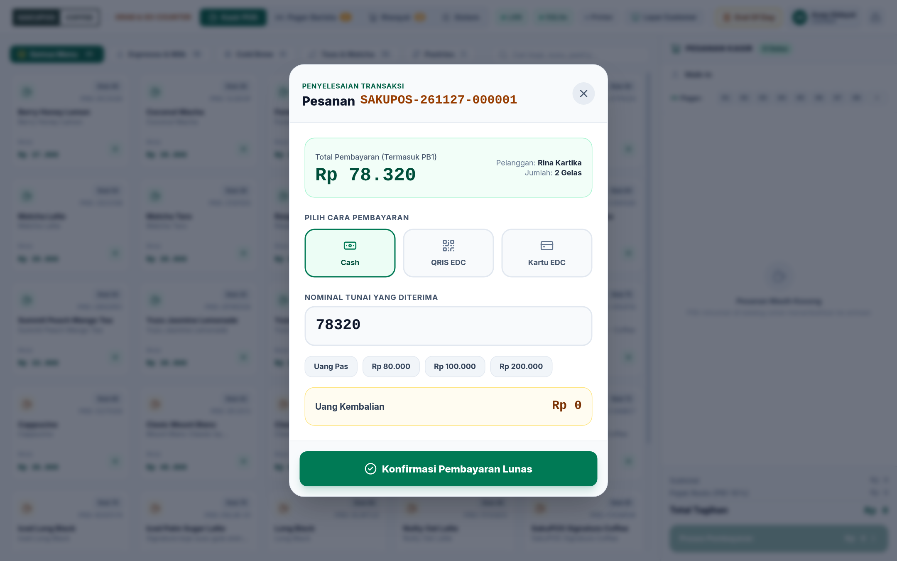
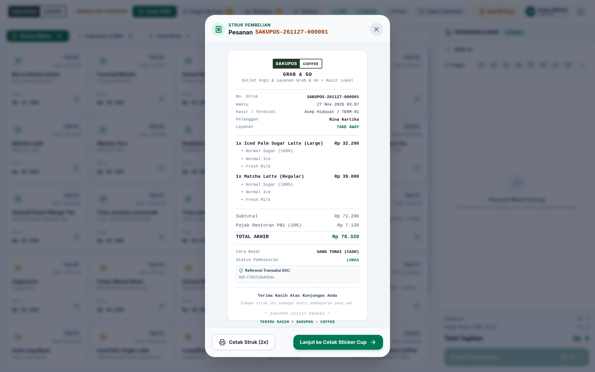
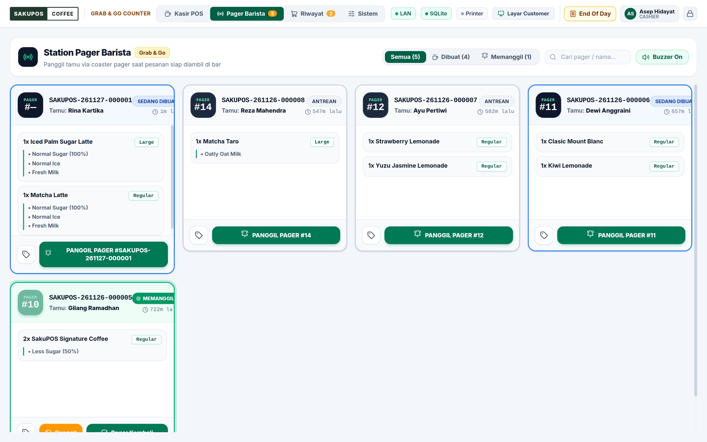
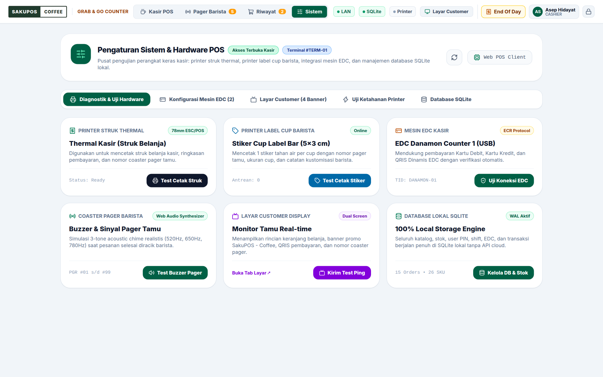
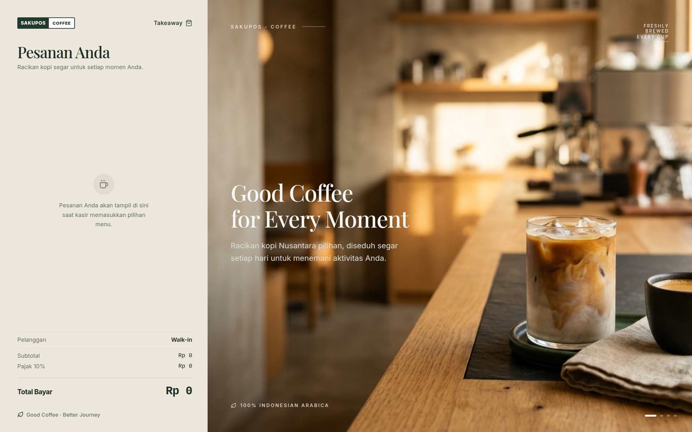

# SakuPOS - Coffee

Sistem Point of Sale (POS) dan operasional konter kedai kopi modern berbasis arsitektur **100% lokal (SQLite + LAN WebSocket)** yang dirancang untuk kecepatan layanan konter (*grab-and-go* & *dine-in*), koordinasi barista (*Kitchen Display System*), integrasi perangkat kasir (*EDC*, printer struk termal, printer stiker label gelas), serta layar pelanggan (*Customer Facing Display*).

---

## 1. Description

**SakuPOS - Coffee** adalah aplikasi kasir (*Point of Sale*) dan manajemen stasiun barista khusus kedai kopi yang dibangun untuk mengeksekusi alur pemesanan konter dalam hitungan detik—mulai dari autentikasi kasir ber-PIN 5 digit, pemilihan menu dan kustomisasi *modifier* minuman, penagihan pembayaran (Tunai, QRIS Dinamis, Debit/Kredit EDC), pencetakan struk termal dan stiker label gelas per cup, hingga pemanggilan pelanggan melalui sistem *Guest Pager* di layar barista.

Aplikasi ini berjalan sebagai sistem dua lapis: **Server Transaksi Outlet Lokal** (Node.js + Express 5 + SQLite mode WAL + WebSocket) dan **Antarmuka Klien** yang dapat dijalankan di browser maupun sebagai aplikasi desktop Windows mandiri berbasis Electron. Seluruh data master produk, stok, pengguna, shift, konfigurasi EDC, dan transaksi tersimpan aman di mesin lokal outlet tanpa ketergantungan pada internet atau API cloud eksternal, sekaligus mendukung banyak terminal kasir dan layar barista dalam satu jaringan LAN yang sama.

---

## 2. Overview

Kecepatan konter kedai kopi menuntut antarmuka sentuh yang ringkas, minim salah ketuk, dan sinkron secara *real-time* antara kasir, barista, dan pelanggan. **SakuPOS - Coffee** menyatukan empat area operasional utama dalam satu aplikasi terpadu:

1. **Kasir POS (`Kasir POS`)** — Katalog menu responsif dengan filter kategori, pencarian instan, indikator stok *real-time*, pemetaan *modifier* otomatis per jenis minuman, manajemen keranjang, serta pemilihan nomor *coaster pager*.
2. **Stasiun Barista & Pager (`Pager Barista` / KDS)** — Papan antrean pesanan *real-time* via WebSocket yang menampilkan ukuran gelas, detail *modifier*, catatan khusus, pratinjau/cetak ulang stiker label gelas (`50×30 mm`), serta pemanggilan *Guest Pager* dengan *synthesizer chime* 3 nada.
3. **Riwayat & Rekonsiliasi Shift (`Riwayat` & `End Of Day`)** — Daftar pesanan lunas maupun tertunda (*unpaid*), pelunasan atau pembatalan pesanan dengan pemulihan stok otomatis, serta penutupan shift (*EOD / Z-Report*) lengkap dengan rekonsiliasi uang fisik laci kasir.
4. **Diagnostik & Manajemen Perangkat (`Sistem`)** — Pusat pengujian perangkat keras (printer struk 78/80mm, printer stiker label cup, buzzer pager), manajemen konfigurasi & uji koneksi mesin EDC (USB Serial / TCP), editor slide promosi *Customer Display*, serta inspeksi kesehatan database SQLite lokal.

Selain itu, tersedia mode **Layar Pelanggan (`Customer Facing Display`)** yang terbuka pada monitor kedua untuk menampilkan rincian keranjang belanja secara langsung, status pembayaran QRIS/EDC, nomor *pager* siap ambil, dan *carousel* banner promosi kedai kopi.

---

## 3. Client

Produk **SakuPOS - Coffee** ditujukan sebagai solusi sistem kasir *white-label* yang siap digunakan oleh:
- **Kedai Kopi & Kafe Grab-and-Go** dengan volume antrean konter tinggi yang membutuhkan waktu input pesanan cepat dan koordinasi langsung ke bar.
- **Gerai Minuman Artisan (Kopi, Teh, Matcha, Cold Brew & Pastry)** yang membutuhkan aturan *modifier* fleksibel per SKU serta pencetakan label gelas otomatis.
- **Operator Outlet Multi-Terminal di Lokasi Terbatas Sinyal/Offline** yang membutuhkan keandalan database lokal di LAN tanpa risiko terhentinya transaksi saat internet terputus.

---

## 4. Service

Cakupan layanan perancangan dan pengembangan **SakuPOS - Coffee** meliputi:
- **UI/UX Design & Front-End Engineering**: Antarmuka layar sentuh untuk kasir, modal kustomisasi *modifier*, *Kitchen Display System* (KDS), serta *Customer Facing Display* bergaya editorial.
- **Local-First Backend & Real-Time LAN Sync**: Arsitektur server outlet berbasis Express 5, SQLite (`node:sqlite` WAL mode), dan WebSocket (`ws`) untuk konsistensi nomor order harian, stok produk, dan status antrean antar-terminal.
- **Hardware & Peripheral Integration**:
  - Integrasi mesin EDC (USB Serial & TCP/IP) melalui modul `serialport` dan protokol ECR untuk Debit, Kredit, dan QRIS Dinamis.
  - Antrean cetak (*Print Queue Worker*) untuk struk termal 78/80mm (salinan Pelanggan & Toko) serta stiker label cup `50×30 mm` melalui transport *Mock*, *ESC/POS Network*, atau *Windows System Spooler*.
- **Desktop Packaging**: Pemaketan aplikasi desktop Windows menggunakan Electron 45 dan *installer* NSIS (`SakuPOS-Coffee-Setup`).

---

## 5. Tech Stack

| Lapisan | Teknologi |
| :--- | :--- |
| **Antarmuka (Frontend)** | React 19, TypeScript 7, Tailwind CSS 4, Vite 8, Lucide React, `qrcode.react` |
| **Server Outlet Lokal** | Node.js, Express 5, `tsx`, WebSocket (`ws`) |
| **Database Lokal** | SQLite (`node:sqlite`, mode WAL) dengan *auto-seeder* idempoten |
| **Desktop & Packaging** | Electron 45, `electron-builder`, installer Windows NSIS |
| **Integrasi Perangkat** | `serialport` (EDC USB/Serial & TCP ECR), *Print Queue* ESC/POS & Windows Spooler (struk 80mm & label cup 50×30mm), Web Audio API (Pager Buzzer) |
| **Pengujian Otomatis** | `node:test` via `tsx` (uji integrasi stok, EDC, transaksi konkuren, KDS, EOD, dan seeder) |
| **Tooling & Dev** | Bun / npm scripts, `concurrently`, `dotenv`, `cross-env` |

---

## 6. Features

- **Autentikasi PIN 5 Digit Berbasis Peran**: Mendukung peran `CASHIER`, `BARISTA`, `SUPERVISOR`, dan `MANAGER` lengkap dengan *lock screen* terminal.
- **Katalog Menu & Manajemen Stok Real-Time**: 26 SKU awal lintas kategori (*Espresso & Milk*, *Artisan Teas & Non-Coffee*, *Pastries & Snacks*) dengan harga *Regular (12 oz)* & *Large (16 oz)*, pengurangan stok otomatis saat order dibuat, penandaan otomatis *Sold Out*, dan pemulihan stok saat pembatalan.
- **Modifier Dinamis per Kategori Minuman**: Pemetaan otomatis 5 grup modifier (*Sugar Level*, *Ice Level*, *Dairy & Plant Milk*, *Espresso Extra Shot*, *Flavored Syrups*) serta catatan bebas per gelas.
- **Multi-Metode Pembayaran & Integrasi EDC**: Mendukung Tunai (dengan preset nominal cepat dan hitung kembalian), QRIS Dinamis EDC, Kartu Debit EDC, dan Kartu Kredit EDC dengan *state machine* pembayaran yang aman terhadap status `UNKNOWN`.
- **Cetak Struk Termal & Label Gelas per Cup**: Pemisahan job cetak `RECEIPT` (2 salinan) dan `CUP_LABEL` (`50×30 mm` per gelas dengan indeks `1/N`, *modifier*, suhu `ICE/HOT`, nama pelanggan, dan penanda `*** REPRINT ***`).
- **Barista KDS & Sistem Guest Pager**: Antrean bar *real-time* via WebSocket, filter status (*Semua*, *Dibuat*, *Memanggil*), panggilan *coaster pager* `#01`–`#99` dengan *audio chime*, serta pencatatan waktu tunggu.
- **Customer Facing Display (Dual Screen)**: Sinkronisasi *real-time* keranjang belanja, total pajak PB1 10%, tampilan instruksi bayar/QRIS, dan manajemen *carousel* slide promo dengan unggah gambar kustom.
- **Manajemen Shift & Closing EOD (Z-Report)**: Pembukaan shift otomatis, rekap penjualan per metode bayar, rekonsiliasi uang fisik kasir terhadap ekspektasi kas laci, dan cetak laporan Z-Report.
- **Multi-Terminal LAN & Mode 100% Offline**: Satu server outlet lokal melayani beberapa perangkat kasir dan stasiun barista di jaringan LAN tanpa perlu koneksi internet.

---

## 7. Screenshots

Berikut 8 tangkapan layar unggulan dari aplikasi **SakuPOS - Coffee** yang berjalan langsung di atas database SQLite lokal:

1. **Layar Kunci & Autentikasi PIN Kasir (`01-pin-login.png`)**
   Tampilan masuk kasir dengan keypad sentuh besar untuk PIN 5 digit berbasis autentikasi SQLite lokal.
   

2. **Antarmuka Kasir POS & Keranjang Pesanan (`02-pos-counter.png`)**
   Katalog menu dengan filter kategori, pencarian cepat, badge stok *real-time*, panel keranjang, serta pemilih nomor *Guest Pager*.
   

3. **Modal Kustomisasi Ukuran & Modifier Minuman (`03-modifier-modal.png`)**
   Pemilihan ukuran gelas (*Regular* / *Large*), tingkat gula, tingkat es, opsi susu (*Fresh/Oat/Almond/Soy*), serta catatan barista.
   

4. **Modal Penyelesaian Pembayaran (`04-payment-modal.png`)**
   Pemilihan metode pembayaran (*Cash*, *QRIS EDC*, *Kartu EDC*) lengkap dengan preset uang tunai dan perhitungan kembalian otomatis.
   

5. **Pratinjau & Cetak Struk Pembelian Termal (`05-receipt-preview.png`)**
   Pratinjau struk 78/80mm beserta rincian item, *modifier*, pajak PB1 10%, referensi pembayaran, dan tombol lanjut cetak stiker label gelas.
   

6. **Station Pager Barista / Kitchen Display System (`06-barista-kds.png`)**
   Papan antrean pesanan barista *real-time* lengkap dengan badge nomor *pager*, detail racikan per gelas, kontrol buzzer, dan cetak ulang label.
   

7. **Pengaturan Sistem, Hardware & Diagnostik SQLite (`07-system-diagnostics.png`)**
   Panel uji printer termal, uji printer stiker cup, manajemen konfigurasi mesin EDC, pengaturan slide *Customer Display*, serta status database SQLite lokal.
   

8. **Customer Facing Display / Layar Pelanggan (`08-customer-display.png`)**
   Tampilan layar kedua untuk pelanggan dengan ringkasan pesanan *real-time* di panel kiri dan *carousel* promosi SakuPOS - Coffee di panel kanan.
   
